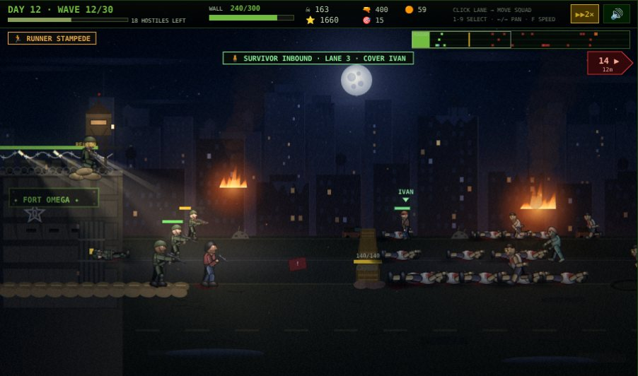
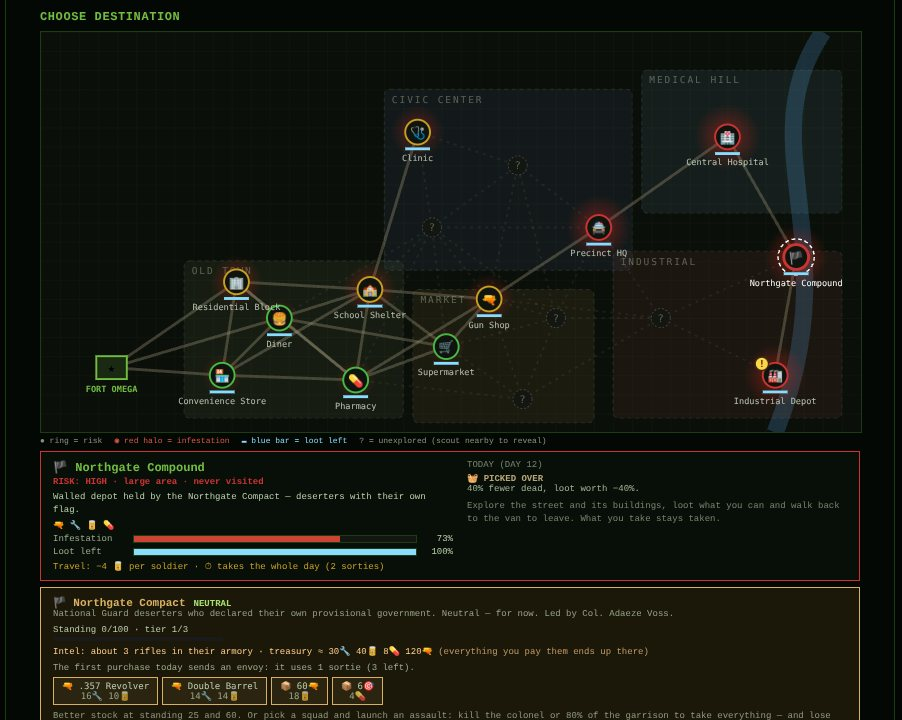
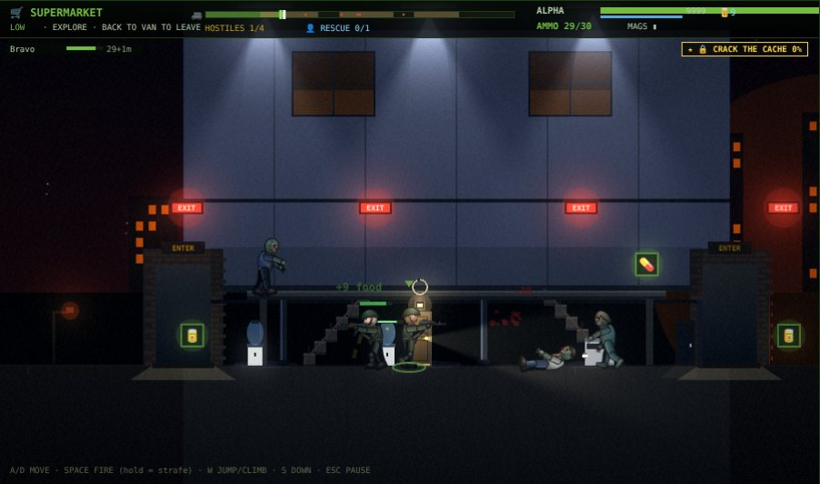
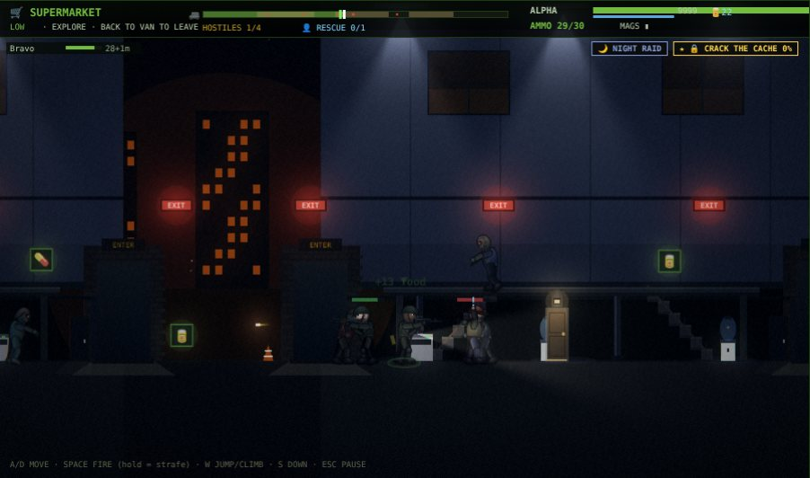
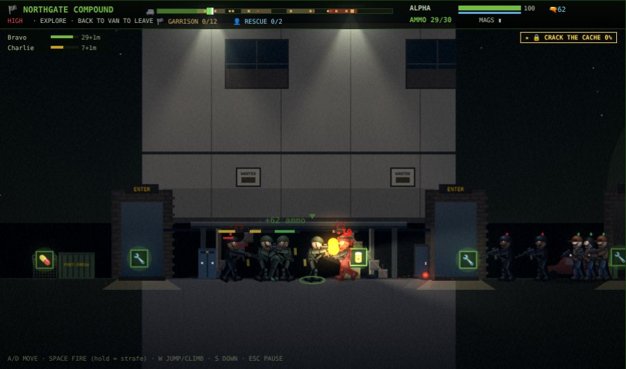
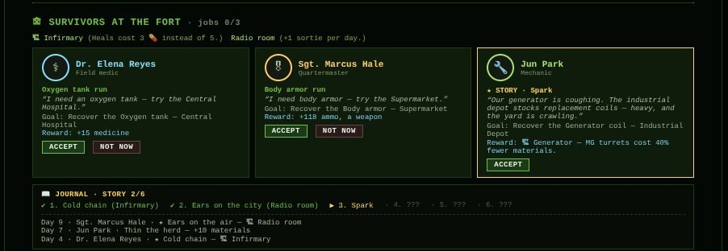

# Dead Perimeter

> A 2D side-scrolling **zombie siege survival** game in React + Canvas 2D.
> Hold **Fort Omega** for **30 waves**. Between waves, send squads into the
> ruined city to scavenge, take jobs from the survivors at the fort, deal
> with — or wipe out — a rogue military faction, and finally carry the
> vaccine out in a playable three-act finale.

  

| | |
| --- | --- |
|  |  |
| **Siege** — three lanes, radar, wave conditions, radio events | **City map** — 17 places that remember infestation and loot |
|  |  |
| **Sortie** — walk into buildings, climb, loot, get back to the van | **Night raid** — rooms behind interior doors, flashlight only |
|  |  |
| **Assault on the Northgate Compact** — soldiers, not zombies | **Command center** — survivors' jobs, main story, journal |

---

## The game

Every day has two halves: **the siege** at night, and **the command
center** during the day, where you spend sorties, resources and skill
points before the next wave.

### The siege
- Hold the wall across **three depth lanes** with up to 6 soldiers, a
  rooftop sniper, machine-gun turrets and barricades.
- Waves come in surges with short lulls. **Wave conditions** change the
  night: fog, moonless night, runner stampede, heavy assault, spitter
  pack. A named **mini-boss** shows up every 5th wave.
- **Radio events** mid-wave: cover a survivor running for the gate, or
  send someone out for a parachuted supply crate.
- From wave 4, every 5 waves, **armed survivor gangs** attack instead of
  the dead.
- Ammo, food and wall HP carry over: the run is an economy as much as a
  shooter. Starving or running dry is how runs usually end.

### Sorties into the city
- A **city map** of 17 places in five districts. Each keeps its
  **infestation** (it grows; killing thins it), **loot left** (what you
  take stays taken) and whether you've **discovered** it yet. Far places
  cost more food and take the whole day (two sortie slots).
- A sortie is a **side-scrolling mission** played live with up to 5
  soldiers (the others follow as AI). The street has 2–4 buildings with
  upper floors, stairs, rooms behind interior doors, searchable
  containers and **locked doors** (find the key, or force it and draw a
  pack). There's no finish line: **walk back to the van** when you've
  had enough. Deeper means richer loot — and a longer way home.
- Daily twists: night raids, hordes, picked-over places, side objectives
  (crack a military cache, burn a nest, answer an SOS), car alarms,
  traders and bandits.
- Ammo on a sortie is the magazines you packed. When a gun runs dry the
  soldier switches to a melee weapon or the knife — and swinging costs
  **stamina**.

### Soldiers and gear
- **Found guns** (AK-47, MP5, .357 Revolver, Hunting Rifle, Double
  Barrel) and **melee weapons** that wear out (bat, machete, fire axe).
  Spares go to the **armory**.
- Soldiers earn **XP and levels** (up to 10) and spend skill points on
  Marksman, Fast Hands, Toughness, Brawler and Endurance.
- A **workbench** (per-soldier perks, crafting) and a **research lab**
  (fort-wide upgrades) are built with materials.

### Survivors and story
Three survivors at the fort — **Dr. Elena Reyes**, **Sgt. Marcus Hale**
and **Jun Park** — hand out jobs: recover an item, rescue someone, clear
a place, hand over supplies. Their **six-step main story** unlocks
permanent upgrades: an infirmary, a radio room (+1 sortie a day), a
generator, faster research, a veteran rifleman, and a better shot at the
finale. The **journal** keeps track.

### The Northgate Compact
The radio room's first catch is a broadcast from **National Guard
deserters** who walled off a depot and declared their own government,
led by **Col. Adaeze Voss**. They're neutral, and the only place to buy
guns.

- **Trade**: one envoy a day (it costs a sortie). Buying raises your
  standing: better stock, then a discount. Everything you pay ends up in
  their treasury, which also grows on its own.
- **Assault**: hit the compound with a squad. Kill Voss or most of the
  garrison and their armory and treasury are yours — and they're gone
  for good. Fail, and they raid the fort every few days.

The longer you trade, the bigger the prize, and the more you lose by
ending it.

### The finale
Survive wave 30 and the vaccine has to leave the city: **Highway 17 →
Central Hospital → Rooftop evac**, played back to back, with a carrier
who drops the case on death and four endings depending on what (and
who) makes it out.

### Presentation
- **HD mode** (default, `G` to toggle): WebGL lighting over Canvas 2D —
  muzzle flashes, flashlights, fires, bloom, grading. Scales itself down
  on slow machines.
- Rigged, shaded characters and zombies drawn in code; no image assets.
- Opening, transmission, evacuation and game-over **cinematics**.
- **Procedural audio** (no sound files) and radio chatter with a voice
  per soldier; optional text-to-speech for transmissions.
- Auto-save between waves, pause anywhere, touch controls on mobile.

---

## Quick start

Requires **Node.js 20+**.

```bash
git clone https://github.com/MasterCruelty/DeadPerimeter.git
cd DeadPerimeter
npm install
npm run dev          # http://localhost:5173
```

Click the canvas once so the browser allows audio.

```bash
npm run build        # static bundle in dist/, serve it anywhere
npm run preview      # http://localhost:4173
```

### Docker

```bash
docker compose up -d                 # production build on nginx → http://localhost:8080
docker compose --profile dev up      # Vite dev server with hot reload → http://localhost:5173
```

The `Dockerfile` is multi-stage (`deps` → `build` → `prod` on
`nginx:1.27-alpine`, plus a `dev` target).

---

## Controls

**Command center and siege**

| Action | Input |
| --- | --- |
| Select a soldier | Click them, or `1`–`9` |
| Move the soldier / the whole squad | Click a spot in a lane |
| Pan the camera | `←` `→` / `A` `D`, or click the radar |
| 2× speed | `F` |
| HD / classic graphics | `G` |
| Pause | `Esc` |
| Place a barricade or turret | Build button, then click a valid spot |
| Skip a cinematic | `Space`, `Esc` or `SKIP →` |

**Sorties**

| Action | Input |
| --- | --- |
| Move | `←` `→` / `A` `D` |
| Climb stairs or ladders / go down | `W` `↑` / `S` `↓` |
| Jump (costs stamina) | `W` `↑` away from stairs and ladders |
| Fire | Hold `Space` or the left mouse button (keep holding to back off while shooting) |
| Melee | Automatic when the gun is dry and an enemy is close |
| Search a container, open an interior door | Stand next to it until the ring fills |
| Force a locked door | Stand at it (loud) — or bring the key |
| Leave | Walk back to the van |
| Trade dialog | `Y` / `N` |
| Pause | `Esc` |

On mobile, tap the left/right thirds of the canvas to move and the
centre to fire.

---

## For developers

The game state is a single mutable object updated by a `requestAnimationFrame`
loop; React only renders the menus and panels from periodic snapshots.
Everything is drawn in code (Canvas 2D + an optional WebGL post-process
pass) and all sound is synthesized with Web Audio.

```
src/
├── DeadPerimeter.jsx   game loop, screens and management panels
├── data/               tables: weapons, zombies, city, quests, faction, rewards, balance
├── entities/           factories, gear, game state, save/load
├── update/             simulation: siege, sortie missions, city layout, quests, faction
├── render/             canvas drawing, rigged actors, lighting / post-fx, cinematics
├── expedition/         sortie results, vaccine finale
├── audio/              procedural sound engine, radio chatter, TTS
└── ui/                 React panels (city map, Compact)
```

See [`CODE.md`](./CODE.md) for the module-by-module reference, invariants
and recipes (adding a weapon, a zombie, a destination…), and
[`PROJECT_STATE.md`](./PROJECT_STATE.md) for design notes.

## License

[MIT](./LICENSE) © 2026 MasterCruelty.
