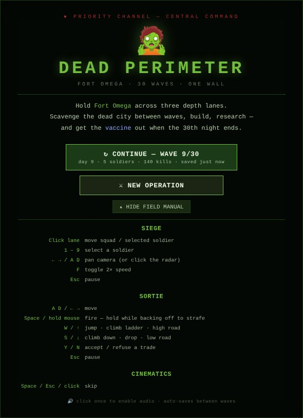
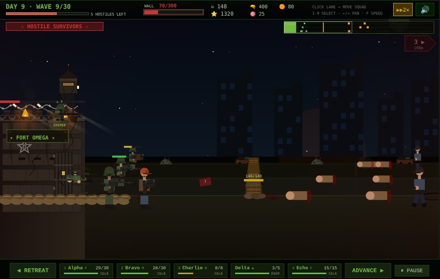
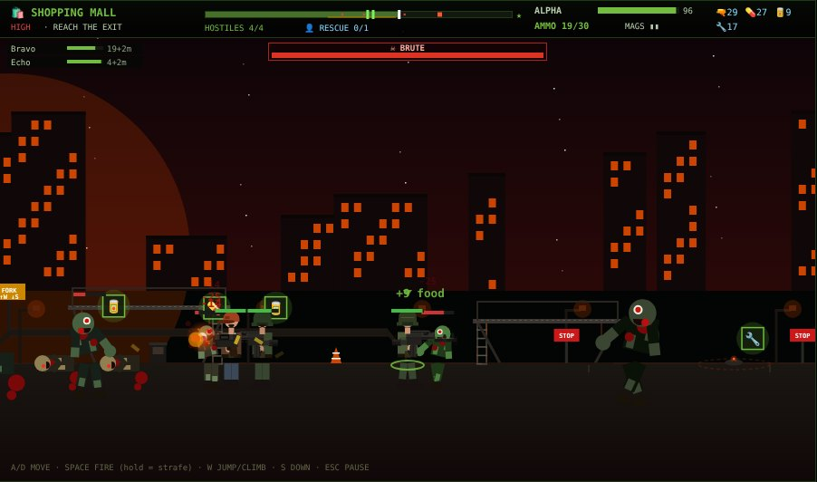
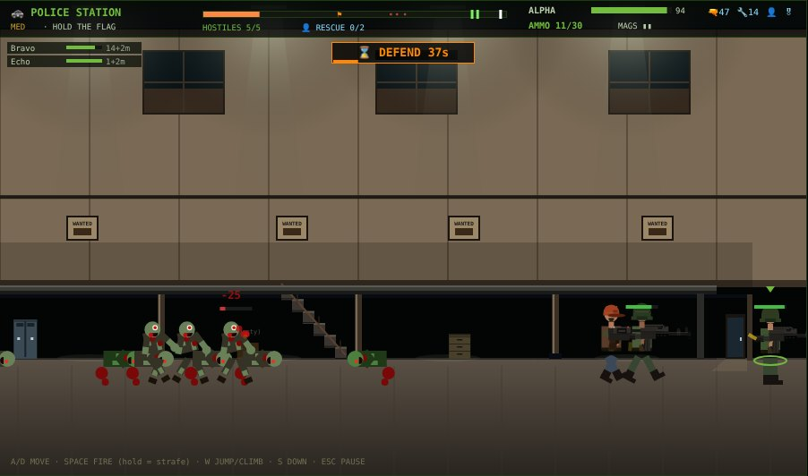
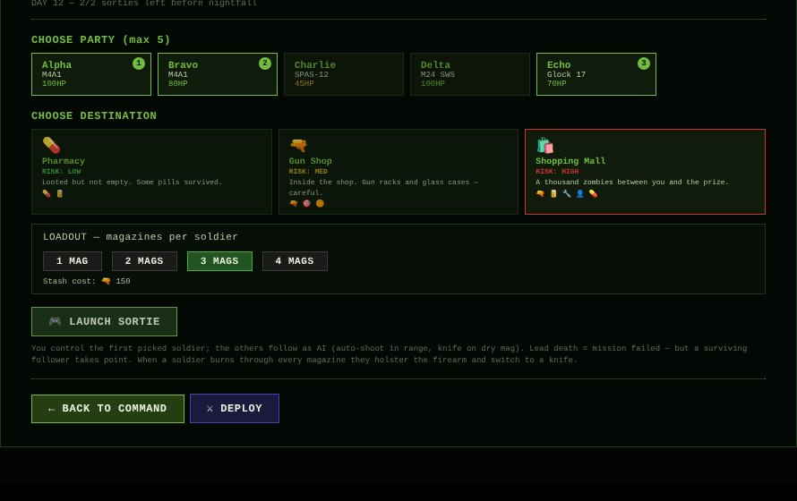
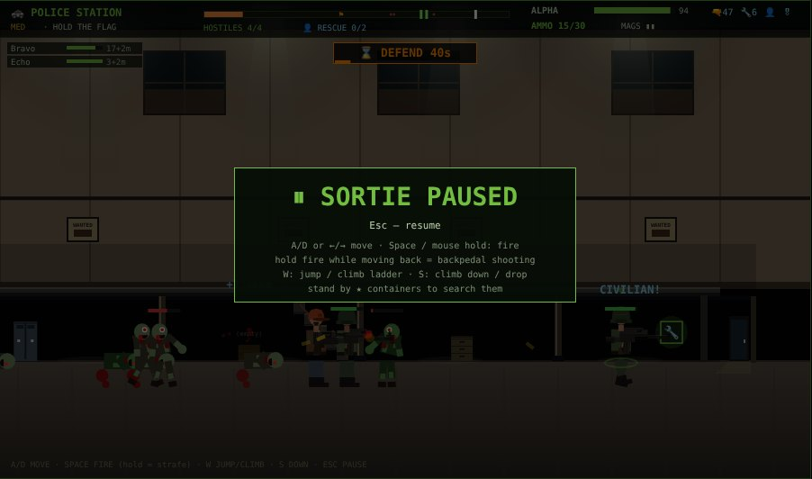

# Dead Perimeter

> A 2D side-scrolling **zombie siege survival** game built in React + Canvas 2D.
> Hold **Fort Omega** across three depth lanes for **30 waves** against the
> dead, hostile survivor gangs, and the occasional Brute boss — then push
> a vaccine sample down Highway 17 to LZ Bravo in a **three-act playable
> finale**. Between waves, send sortie parties into the ruined city as a
> side-scrolling mission with multi-floor buildings, ladders, hazards,
> survivor encounters, and an APC extraction when you hold a defend point
> long enough.

  

---

## Screenshots

| | |
| --- | --- |
|  |  |
| **Title screen** — continue card with save summary, field manual | **Siege** — tactical HUD, radar, wall damage, 2× speed |
|  |  |
| **Sortie (HIGH)** — route bar, party panel, boss HP bar | **Sortie (DEFEND)** — hold timer, APC extraction |
|  |  |
| **Expedition planning** — party, destination, loadout | **Pause** — works in sieges and sorties |

---

## Highlights

### The siege
- **3 depth lanes** (FRONT / MID / BACK) with per-lane scaling, occlusion, and
  click-to-position movement.
- **Wider world** (`WORLD_W = 1980`) — pan the camera with the arrow keys to
  scout the killzone before the wave hits.
- **30-wave run** capped by `BALANCE.maxWaves`. Survive all 30 to unlock the
  playable vaccine delivery finale.
- **Up to 6 active soldiers** plus a reserve roster of up to 10, swappable
  between sieges. Civilians and lost military soldiers rescued on sorties
  join the bench.
- **Delta the rooftop sniper** with a dedicated `sniperAmmo` pool and a
  700 px range — climbs down to fight on the ground when the pool runs dry.
- **Machine-gun turrets** with a dedicated `turretAmmo` pool, built from
  materials. **Click-to-place** with valid-range preview.
- **Barricades** that span all three lanes as a single perspective wall.
  Also click-to-place.
- **Hostile human survivor waves** (every 5 waves from wave 4): knifemen rush
  the wall while gunmen open fire from range. They drop ammo on death.
- **Wave conditions** briefed in the command-center intel before each wave:
  Dense Fog (−35% range, the far field is grey), Moonless Night (−20%
  range, darker), Runner Stampede, Heavy Assault (tanks + brutes) and
  Spitter Pack (ranged acid at soldiers and at the wall).
- **Surge pacing**: waves come in packs with short lulls to reload and
  reposition; tanks and brutes join from the second surge.
- **Spitters and brutes in the siege** from the mid game, and a named
  **mini-boss** every 5th wave (boss bar, salvage bounty on the kill).
- **Mid-wave radio events**: cover a survivor sprinting for the gate (they
  join the reserve) or send a soldier out to recover a parachuted supply
  crate before it's lost.
- **Ammo economy**: the wave-clear resupply scales with the wave
  (`30 + 5 × wave`, capped at 160), Delta gets +2 sniper rounds per wave,
  unused sortie magazines return to the stash, and when the stash runs
  low Command almost always drops an ammo crate mid-wave.
- **Daily food consumption** — every alive squad + reserve member eats
  `BALANCE.foodPerPersonPerDay` per wave-clear. Starvation deals real damage.
- **Wall repair** (`💪 REPAIR`) — spend materials to patch the base wall HP.
- **Tactical HUD**: wave progress + hostiles left, wall HP, stash, a
  **radar** of the whole battlefield (click to pan) and an off-screen
  hostile indicator. **2× fast-forward** (`F`), **1–9** to select soldiers.
- **HD graphics** (default, toggle with `G`): a WebGL layer over the
  Canvas 2D renderer adds dynamic lights (muzzle flashes, tracers,
  floodlights, fires, flashlight indoors), bloom, colour grading,
  vignette and film grain. Falls back to classic Canvas without WebGL.
- **Rigged, shaded characters**: soldiers (recruit / veteran / civilian
  / bandit / police / SWAT), hostile survivors and five zombie builds
  (six walker outfits, runner, spitter, tank, brute) are drawn by a
  skeletal rig with outlined, volume-shaded parts, cached as animation
  frames, with normal maps so HD lights wrap around bodies. Arms are
  IK-driven and stay locked to a recoiling weapon; redrawn weapons.
- **Adaptive HD**: if frames stay slow, HD drops normal maps, then
  resolution, then falls back to classic, with an on-screen note.
- **Layered parallax city** (cached offscreen layers), smoke plumes,
  ground mist, embers, textured asphalt, contact shadows, HiDPI canvas.
- Fort Omega shows **progressive battle damage** (cracks → missing
  chunks → fires) as the wall HP drops.
- **Pause / resume** with `Esc` (sieges *and* sorties), **save / load** to `localStorage` (v3,
  forward-compatible reads for v2/v1), **mobile touch controls**, and a
  **configurable difficulty curve**.

### Workshop progression
Unlocked mid-run by spending materials at the management screen:

- **🔨 Workbench** (30 materials) — unlocks the **per-soldier weapon perks**
  panel. Seven perks: Ballistic Vest (+30 max HP), Extended Mag, Heavy
  Barrel, Hollow Points, Bipod (+150 sniper range), Match Ammo, Quick Reload.
  Each perk is owned per-soldier and persists across saves.
- **🧪 Research Lab** (50 materials + 5 medicine) — unlocks the **research
  queue**. Seven nodes (Improved Magazines, Reinforced Walls, Combat Drills,
  Field Medicine, AP Rounds, Marksmanship, Reload Drills); one active node
  at a time, progresses one tick per wave-clear, effects apply globally
  on completion.
- **🛠 Craft** — convert materials into ammo / medicine / sniper rounds /
  turret belts at the workbench (recipes in `data/difficulty.js`).

### Sorties & missions
- **City map**: sorties start from a map of the city around Fort Omega —
  16 fixed locations in five districts (Old Town, Market, Civic Center,
  Medical Hill, Industrial). Each place keeps its state between visits:
  **infestation** (grows daily, drops when you thin the herd; it sets the
  risk tier), **loot left** (what you take stays taken, slow restock) and
  whether it has been **discovered** — unexplored places show as `?` until
  you scout a location nearby. Travel costs food per soldier by distance.
- **Explore missions** at map locations: a longer street (2600–3800 px)
  with 2–4 buildings to walk into, each with an upper floor and stairs.
  The layout is seeded per location, so it's the same place every time.
  Some buildings are **locked**: find the key in a container before it or
  force the door (slow and loud — it draws a pack). There is no finish
  line: you leave whenever you walk back to the **van**.
Auto-dispatch was retired — every sortie is now **played live**. Single
mode, deeper mission system:

- **Multi-soldier party**: pick up to 3 soldiers. The first is the player
  avatar; the rest follow as AI companions, fire on hostiles in range,
  switch to knife when their mag runs dry.
- **Pre-mission magazine loadout** (`1`–`4` mags per soldier). Each mag
  drawn from the stash at deploy time. Mission ammo is **finite** — no
  free reloads.
- **Lead-down promotion**: when the player avatar falls, a living follower
  is promoted to take point — the mission only fails when the entire party
  is dead.
- **Rotating city destinations**: every sortie session rolls one location
  per risk tier from a pool of 16, each with its own loot table and biome.
  Three new **indoor** destinations:
  - **Police Station** (cells + lockers + evidence room)
  - **Gun Shop** (racks + glass cases — careful, breakable)
  - **Office Tower** (cleared cubicle floor)
- **Six biomes** total: hospital, armory, downtown, plus three indoors —
  police_interior, armory_interior, office_interior.
- **Multi-segment missions**: many destinations are outdoor → indoor in
  one mission. You cross an `entranceX` boundary mid-map.
- **Multi-floor buildings**, **platforms**, **ladders** — climb stairs
  with `W`/`↑` or jump onto ledges (`Space` when grounded, with a forward
  velocity). Zombies climb ladders too. Combat respects Y-levels.
- **Jump ability** — short forward leap, useful for skipping hazards or
  reaching a low platform.
- **Searchable loot containers** (lockers, ammo crates, glass cases, work-
  benches) — hold to search, get random loot based on container type.
- **APC extraction** after a successful DEFEND objective — a 6×6 truck
  rolls in from the Fort Omega side, soldiers board it, then it drives
  back across the map.
- **Three soldier kinds**: standard recruits (cost food + materials),
  rescued civilians (70 max HP, pistol-only), rare lost military soldiers
  (veterans — 120 HP, sniper-capable).
- **Mission objectives**: REACH (run-to-the-goal) or DEFEND (hold a sandbag
  emplacement for 45 s, then call in the APC extraction).
- **Branching paths** in some non-defend MED+HIGH missions: high and low
  lanes with exclusive pickup clusters; switch with `W` / `S`.
- **Hazards**: shootable AOE mines + acid pools (slow + damage tick).
- **Ranged zombies** (Spitters), **Brutes** (HIGH-risk end-of-stage boss),
  Tanks, Runners, Walkers — wave-scaled.
- **Mission conditions** shown on the destination cards: Night Raid (the
  dead wake later, darker), Horde (+60% dead, +50% loot), Picked Over.
- **Optional side objectives** with their own rewards: crack a military
  cache (stand by it while the noise draws a pack), burn a zombie nest that
  keeps spawning walkers, or answer an SOS before the timer runs out.
- **Car alarms** on some routes: walk past and a pack closes in from both
  sides.
- **Survivor encounters** mid-mission: peaceful trader camps (offer trades
  via a centered dialog — accept to swap resources, refuse to fight) or
  hostile bandits (immediate firefight). Zombies leave both camps alone
  until the camp activates.

### Cinematics, story, audio
- **Opening cinematic** (50 s, 14 storyboarded shots): café patron reading
  a CITY ALERT on his phone, the outbreak hitting, NHPD containment line
  with peaked caps and SWAT helmets, the line falling, a burning city, a
  military convoy of Humvees + 6×6 troop truck rolling toward Fort Omega.
- **Intermediate transmissions** at waves **10, 20, 25** — full-screen
  radio overlays from Central Command with a waveform animation, scripted
  dialog lines (Web Speech TTS via `audio/radioVoice.js`), and a parachuted
  **supply drop** landing on the perimeter when the cinematic ends.
- **Game-over cinematic** (24 s): the wall is breached, the perimeter is
  overrun, defenders fall one by one (each visibly mauled by a specific
  zombie), Alpha makes a last stand and goes to knife when his ammo runs
  out, and finally Fort Omega has fallen.
- **🎯 Wave 30 vaccine delivery finale** — three playable scenarios
  back-to-back (**Highway 17 → Central Hospital → Rooftop Evac**) with
  a vaccine-carrier mechanic (drops on death, recoverable by teammates),
  a scripted Brute boss at the rooftop, and **four endings**:
  - 🏆 **Gold** — vaccine delivered + ≥4 survivors
  - 🥈 **Silver** — vaccine delivered + 1-3 survivors
  - 🥉 **Bronze** — extracted but vaccine lost en route
  - ☠ **Failure** — convoy lost
- **Helicopter evacuation animation**: a procedural UH-60 Black Hawk flies
  in, hovers over the wall, civilians ascend a rope ladder to the open
  cargo door, and the chopper departs.
- **Tactical radio chatter** with **per-soldier voice pitch** (deterministic
  hash of name → six tonal steps), HUD subtitles, and triggered events:
  ADVANCE / RETREAT, reload, low-HP "I'm hit", kill confirmation, evac
  pilot callouts, and defeat lines. Optional **Web Speech TTS** layer
  for transmission dialog (toggle 🗣 / 🚫 in the HUD).
- **Procedural Web Audio** for everything (no audio files): gunshots,
  reloads, zombie groans, base hits, kick beats, helicopter rotor, city
  hum, wind, sirens, screams, fire crackle, two-tone musical sting,
  parachute rustle.

### Stats & persistence
- **End-of-run stats**: Play Time (cumulative across save/load), Soldiers
  Lost, Civilians Lost — tracked via `recordDeath(gs, victim)` at every
  death site in `update/siege.js` and `expedition/missionFinish.js`.
- **Save format v3** (`dead-perimeter-save-v3` in `localStorage`).
  Auto-saves on wave-clear, recruit, build, heal, bench/activate, EVAC.

---

## Requirements

| | |
| --- | --- |
| Node.js | **20 or newer** (Vite 5 dropped support for older versions) |
| Package manager | npm 10+ (bundled with Node 20) |
| Browser | Anything modern with Canvas 2D + Web Audio (Chrome, Firefox, Safari, Edge). Optional Web Speech for transmission voices. |
| OS | Linux, macOS, Windows. Tested on Linux. |

A `.nvmrc` file pinning Node 20 is included. If you use `nvm`:

```bash
nvm use   # picks up .nvmrc
```

If `node -v` reports an older version, upgrade via your package manager or
NodeSource:

```bash
# Debian / Ubuntu / Raspberry Pi OS
curl -fsSL https://deb.nodesource.com/setup_20.x | sudo -E bash -
sudo apt install -y nodejs
```

---

## Quick start

```bash
git clone https://github.com/MasterCruelty/code/DeadPerimeter.git
cd DeadPerimeter
npm install
npm run dev
```

Then open `http://localhost:5173/` in a browser. **Click the canvas once** so
the browser unlocks the AudioContext (browser autoplay policy), then play.

### Production build

```bash
npm run build       # bundles to dist/
npm run preview     # serves dist/ on http://localhost:4173
```

The game is fully client-side. `dist/` can be served by any static host
(nginx, Caddy, GitHub Pages, Netlify, `npx serve dist`, etc.).

---

## Running with Docker

The repo ships with a multi-stage `Dockerfile` and a `docker-compose.yml`
so you can run the game in a fully isolated container — no local Node
install required.

### Production (nginx serves the static bundle)

```bash
docker compose up -d                # → http://localhost:8080
docker compose logs -f              # tail nginx logs
docker compose down                 # stop and remove the container
```

The image is built by the `prod` stage:
- Stage 1 (`deps`)  → `node:20-alpine`, installs dependencies via `npm ci`.
- Stage 2 (`build`) → runs `npm run build`, emits `/app/dist`.
- Stage 3 (`prod`)  → `nginx:1.27-alpine` with our `nginx.conf` (gzip,
  hashed-asset caching, SPA fallback), serving `dist/` on port 80.
- Built-in `HEALTHCHECK` hits `http://127.0.0.1/`.

You can also build it directly with the Docker CLI:

```bash
docker build -t dead-perimeter .
docker run --rm -p 8080:80 dead-perimeter
```

### Development (Vite dev server with hot reload)

```bash
docker compose --profile dev up     # → http://localhost:5173
```

This builds the `dev` stage of the Dockerfile, mounts your source tree
into `/app`, and starts `npm run dev`. Edits on the host trigger HMR
inside the container. `CHOKIDAR_USEPOLLING=true` is set so file watching
is reliable across the bind mount on every host platform.

Direct CLI equivalent:

```bash
docker build --target dev -t dead-perimeter:dev .
docker run --rm -it -p 5173:5173 \
  -v "$PWD":/app -v /app/node_modules \
  dead-perimeter:dev
```

### Notes

- Image size: ~50 MB for the prod image (alpine + nginx + ~1 MB of static
  assets) and ~350 MB for the dev image (alpine + Node 20 + node_modules).
- The Dockerfile uses no privileged build flags and no BuildKit-only
  syntax — it builds on any Docker ≥ 20.10.
- `.dockerignore` excludes `node_modules`, `dist`, `.git`, and editor /
  OS junk from the build context.

---

## Controls

### Menu / management

| Action | Input |
| --- | --- |
| Start a new game | `⚔  BEGIN OPERATION` (plays the 50 s intro cinematic) |
| Continue a saved game | `↻  CONTINUE SAVED RUN` (skips the intro) |
| Skip a cinematic | `SKIP →` button top-right of canvas, or `Space` / `Esc` |
| Place a barricade / turret | Click the build button → click on the validated range in the canvas |

### Siege screen

| Action | Input |
| --- | --- |
| Select a soldier | Click on them in the canvas, or press `1`–`9` |
| Deselect | Click the same soldier again |
| Move the selected soldier to a lane | Click on an empty spot in the desired lane |
| Move the whole squad (no selection) | Click anywhere on the battlefield |
| Pan the camera | `←` / `→` or `A` / `D`, or click the radar strip |
| Fast-forward | `F` or the `▶ 1×` / `▶▶ 2×` button |
| Graphics mode | `G` or the `✨ HD` / `▭ CLASSIC` button (HD = WebGL lighting, bloom, grading) |
| Retreat / advance | `◀ RETREAT` / `ADVANCE ▶` buttons (also fires radio chatter) |
| Pause / resume | `Esc` or the button under the canvas |
| Mute / unmute | Speaker icon in the top-right of the canvas |
| Toggle TTS radio voice | 🗣 / 🚫 icon (only shown when Web Speech is available) |

Lanes are picked by Y coordinate of the click:
`above GY-50 → BACK`, `above GY-20 → MID`, `else → FRONT`.

### Playable expedition (mission)

| Action | Input |
| --- | --- |
| Move left / right | `←` / `→` or `A` / `D` (or tap left/right thirds of canvas on mobile) |
| Climb / drop floor (ladders & stairs) | `W` / `↑` (up), `S` / `↓` (down) |
| Jump | `W` / `↑` when not next to a ladder |
| Switch lane (in fork sections) | `W` / `S` |
| Fire | `Space` (held) or **left-mouse hold** on the canvas (or tap-center on mobile) |
| Backpedal while shooting | Keep fire held while moving away — facing stays locked |
| Pause | `Esc` |
| Accept / refuse a trade | `Y` (or `Enter`) / `N`, or click the buttons |
| Knife (when dry) | Auto-swing in melee range |
| Search a container | Hold proximity until the bar fills (lockers, ammo crates, glass cases, etc.) |
| Accept / refuse a trade offer | Click the `✓ ACCEPT` or `✖ REFUSE (fight)` button in the dialog |
| Return to base | "RETURN TO BASE" button once the mission ends (or "ADVANCE TO …" / "COMPLETE EXTRACTION" during the wave-30 vaccine campaign) |

---

For module-by-module developer documentation see [`CODE.md`](./CODE.md).
For the design / architecture handoff see [`PROJECT_STATE.md`](./PROJECT_STATE.md).

## Architecture overview

```
src/
├── DeadPerimeter.jsx          React component + game loop only
├── App.jsx  main.jsx           bootstrap
├── constants.js                CW, CH, GY, WX, WORLD_W, LANES, palette, helpers
├── audio/
│   ├── AudioEngine.js          procedural Web Audio (no samples)
│   ├── radio.js                RADIO_LINES + pushRadio (tactical chatter)
│   └── radioVoice.js           Web Speech TTS layer for transmissions
├── data/
│   ├── weapons.js              WPN dictionary
│   ├── zombies.js              ZTP (walker, runner, tank, spitter, brute)
│   ├── humans.js               HTP (knifeman, gunman), wave cadence
│   ├── biomes.js               6 biomes (3 outdoor + 3 indoor)
│   ├── difficulty.js           DIFFICULTY, BALANCE, CRAFT_RECIPES,
│   │                           RESEARCHES, PERKS + helpers
│   ├── expeditions.js          DEST_POOL, RISK_BASE, TRADE_OFFERS,
│   │                           rollDestinations, rollEncounter, weapon
│   │                           pools, KIND_HP, objIcons
│   ├── transmissions.js        Wave-10/20/25 Central Command scripts + drops
│   └── vaccineMission.js       Wave-30 three-scenario script
├── entities/
│   ├── soldier.js              mkSoldier (kind, voicePitch, upgrades{})
│   ├── zombie.js   human.js    barricade.js  turret.js  wave.js
│   ├── gameState.js            mkGS + recordDeath helper
│   └── persistence.js          save/load (v3) to localStorage
├── render/
│   ├── background.js  base.js  weapons.js
│   ├── soldier.js  zombie.js  human.js  turret.js  effects.js  hud.js
│   ├── evac.js                 UH-60 Black Hawk helicopter cinematic
│   ├── intro.js                50 s opening cinematic (14 shots)
│   ├── defeat.js               24 s game-over cinematic
│   ├── transmission.js         Wave-10/20/25 full-screen radio overlay
│   └── extraction.js           (legacy wave-30 convoy cinematic, kept for
│                                stale-save compatibility — superseded by
│                                the playable vaccine campaign)
├── update/
│   ├── siege.js                main tick — branches on isHumanWave
│   └── mission.js              playable side-scroll mission engine
└── expedition/
    ├── missionFinish.js        finishMission (live mission → game state)
    └── vaccineCampaign.js      wave-30 three-scenario campaign factory +
                                 advance + finalize with four-tier ending
```

Architectural rules worth preserving (see `PROJECT_STATE.md` §18):

1. Game state lives in a **single mutable object** held by a `useRef`. React
   only sees periodic snapshots via `setUi`, not every frame.
2. **The render loop checks override refs first**: `introRef` → `defeatRef` →
   `evacRef` → `transmissionRef` → `extractionRef` → `missionRef` →
   `gs.phase === 'siege'`. Each cinematic phase owns the canvas fully when
   active.
3. The **lane scale** is applied on the canvas transform, never baked into
   entity coordinates.
4. **Audio uses a per-frame queue** (`gs.soundQ`, `m.soundQ`, etc.) drained
   at end-of-update so sound triggers are decoupled from the AudioContext.

---

## Roadmap

Tracked in [`PROJECT_STATE.md`](./PROJECT_STATE.md) §17.

- ✅ Hostile human survivor waves
- ✅ Pause / resume / save / load (v3 format) / touch controls
- ✅ Multi-soldier playable expeditions with AI followers
- ✅ Pre-mission magazine loadout (finite mission ammo, no free reloads)
- ✅ Jump ability + auto-knife when dry
- ✅ Multi-floor buildings + platforms + ladders + Y-level combat
- ✅ Outdoor → indoor multi-segment missions
- ✅ Searchable loot containers + APC extraction after defend
- ✅ Mines + acid pools + Spitter + Brute boss
- ✅ DEFEND objective + sandbag emplacement
- ✅ Branching mission paths (high / low lanes)
- ✅ Survivor encounters (bandits + trader dialog)
- ✅ Helicopter evacuation animation
- ✅ Opening + defeat cinematics with procedural audio
- ✅ Wave-10/20/25 transmission cinematics with supply drops + TTS
- ✅ Wave-30 playable vaccine delivery finale (3 scenarios, carrier
     mechanic, boss zombie, four ending tiers)
- ✅ Tactical radio chatter with per-soldier voices + optional Web Speech
- ✅ Civilian / veteran / lost-soldier rescue kinds
- ✅ Machine-gun turrets with dedicated ammo pool + click-to-place
- ✅ Reserve roster (10 slots) + bench / activate
- ✅ Workshop (workbench + research lab + crafting recipes + per-soldier
     weapon perks)
- ✅ Wider WORLD_W (1980 px) + manual camera scroll
- ✅ Daily food consumption + wall repair + wave-clear stat tally
- ⏳ Optional real audio samples
- ⏳ Sprite caching (offscreen canvas) for perf

---

## License

[MIT](./LICENSE) © 2026 MasterCruelty.
