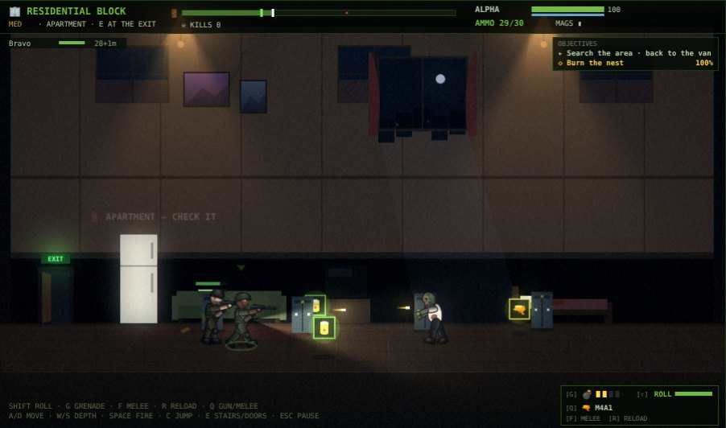
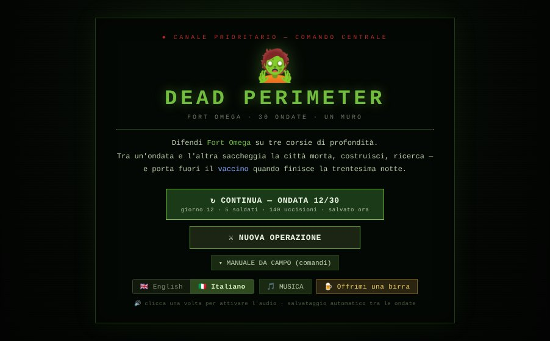
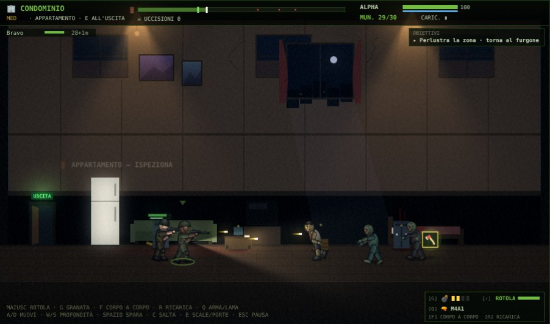

# Dead Perimeter

> A 2D side-scrolling **zombie siege survival** game in React + Canvas 2D.
> Hold **Fort Omega** for **30 waves**. Between waves, send squads into the
> ruined city to scavenge, take jobs from the survivors at the fort, deal
> with — or wipe out — a rogue military faction, and finally carry the
> vaccine out in a playable three-act finale.

  

**▶ [Play in the browser](https://mastercruelty.github.io/DeadPerimeter/)** — no install needed. Progress is saved in your browser.

| | |
| --- | --- |
|  |  |
| **Siege** — three lanes, radar, wave conditions, radio events | **City map** — 17 places that remember infestation and loot |
|  |  |
| **Sortie** — a street with depth: line up to hit, loot, get back to the van | **Rooms** — press E at a door: apartments, clinics, storage, armories |
|  |  |
| **Assault on the Northgate Compact** — soldiers, not zombies | **Command center** — survivors' jobs, main story, journal |
|  |  |
| **English / Italiano** — pick the language on the title screen | **Fully translated** — HUD, missions, story and radio voices |

---

## The game

Every day has two halves: **the siege** at night, and **the command
center** during the day, where you spend sorties, resources and skill
points before the next wave.

### The siege
- Hold the wall across **three depth lanes** with up to 6 soldiers, a
  rooftop sniper, machine-gun turrets and barricades. Zoom in on the
  fight with the mouse wheel.
- Waves come in surges with short lulls. **Wave conditions** change the
  night: fog, moonless night, runner stampede, heavy assault, spitter
  pack. A named **mini-boss** shows up every 5th wave.
- **Radio events** mid-wave: cover a survivor running for the gate, or
  send someone out for a parachuted supply crate.
- From wave 4, every 5 waves, **armed survivor gangs** attack instead of
  the dead.
- Ammo, food and wall HP carry over: the run is an economy as much as a
  shooter. Holding the wall burns more ammo than Command sends after
  each wave, so the stash only grows if you go out and get it.

### Sorties into the city
- A **city map** of 17 places in five districts. Each keeps its
  **infestation** (it grows; killing thins it), **loot left** (what you
  take stays taken) and whether you've **discovered** it yet. Far places
  cost more food and take the whole day (two sortie slots).
- A sortie is a **side-scrolling mission** played live with up to 5
  soldiers (the others follow as AI). The street has **depth**, like a
  beat-'em-up: walk across it with `W` / `S`. Shots, bites and blows
  only land when lined up, and wrecked cars stop bullets. The street
  has 2–4 buildings with upper floors, stairs and searchable
  containers; the squad takes the stairs after you and lines up on the
  floor. Doors in their back
  walls lead to **rooms** (press `E`): apartments, offices, clinics,
  storage and arms lockers, each with its own dead and better loot.
  Some streets are blocked by a **chained barricade**: find bolt cutters
  or tear it down (loud — it draws a pack). There's no finish line:
  **walk back to the van** when you've had enough. Deeper means richer
  loot — and a longer way home.
- Civilians don't go on sorties. When fewer than two soldiers are fit
  to go, **ask for volunteers**: each civilian in the squad says yes or
  no (same answer all day, a new chance the next). Volunteers keep
  their civilian HP, aim worse and tire sooner.
- Armed survivors and Compact soldiers react like soldiers: they wake
  up when you come within their range, answer fire when shot from afar
  and alert each other.
- Daily twists: night raids, hordes, picked-over places, side objectives
  (crack a military cache, burn a nest, answer an SOS), car alarms,
  traders and bandits.
- The lead soldier can **roll** out of a bite (a moment of
  invulnerability, costs stamina; across the street too), throw
  **grenades** (two per sortie, more in containers and storerooms;
  `W` / `S` lob them toward the back or the front; the blast wakes the
  street),
  **reload** by hand, sling the gun for the **melee** weapon and swing
  it at will. Hits land with a short freeze, guns kick the camera and a
  boss going down slows time for a moment.
- Ammo on a sortie is the magazines you packed. When a gun runs dry the
  soldier switches to a melee weapon or the knife — and swinging costs
  **stamina**.
- The HUD lists the **objectives**: the main goal, the job you took at
  this place and the side objective, with live counters (garrison left,
  SOS time left) and a check mark when one is done.
- Every sortie ends with a **report**: time against par, kills,
  accuracy, damage taken, losses, side objective, loot, and a grade
  from S to C. The best grade for each place is kept as a record. Each
  siege wave and the finale get a grade too.

### Soldiers and gear
- Rescued **civilians** join the reserve and are there to be brought to
  safety: call the **helicopter evac** from the command center once
  three are waiting, for supplies in return. Civilians moved into the
  squad help hold the wall.
- **Found guns** (AK-47, MP5, .357 Revolver, Hunting Rifle, Double
  Barrel) and **melee weapons** that wear out (bat, machete, fire axe).
  Spares go to the **armory**.
- Soldiers earn **XP and levels** (up to 10) and spend skill points on
  Marksman, Fast Hands, Toughness, Brawler and Endurance.
- A **workbench** (per-soldier perks, crafting) and a **research lab**
  (fort-wide upgrades) are built with materials.

### Survivors and story
Three survivors at the fort — **Dr. Elena Reyes**, **Sgt. Marcus Hale**
and **Jun Park** — hand out jobs: recover an item, rescue someone, clear
a place, hand over supplies. Their **six-step main story** unlocks
permanent upgrades: an infirmary, a radio room (+1 sortie a day), a
generator, faster research, a veteran rifleman, and a better shot at the
finale. The **journal** keeps track.

### The Northgate Compact
The radio room's first catch is a broadcast from **National Guard
deserters** who walled off a depot and declared their own government,
led by **Col. Adaeze Voss**. They're neutral, and the only place to buy
guns.

- **Trade**: one envoy a day (it costs a sortie). Buying raises your
  standing: better stock, then a discount. Everything you pay ends up in
  their treasury, which also grows on its own.
- **Assault**: hit the compound with a squad. Kill Voss or most of the
  garrison and their armory and treasury are yours — and they're gone
  for good. Fail, and they raid the fort every few days.

The longer you trade, the bigger the prize, and the more you lose by
ending it.

### The finale
Survive wave 30 and the vaccine has to leave the city: **Highway 17 →
Central Hospital → Rooftop evac**, played back to back, with a carrier
who drops the case on death and four endings depending on what (and
who) makes it out. Each act starts with a **checkpoint**: if the squad
is wiped or the vial is lost, retry the act from where it began or
accept the outcome. Retries count against the finale's grade.

### Presentation
- **English and Italian**: pick the language on the title screen or in
  the command center (it follows the browser's language the first time).
  Everything is translated, radio voices included: they speak the chosen
  language when the device has a voice for it.
- **HD graphics**: WebGL lighting over Canvas 2D — muzzle flashes,
  flashlights, fires, bloom, grading — always at full quality.
- Rigged, shaded characters and zombies drawn in code; no image assets.
  Dozens of outfits for civilians, soldiers and the dead, and every
  named mini-boss has its own look. Each soldier keeps the same face at
  the wall, on sorties, on the radio and in the squad and reserve lists.
  Raiders and Compact troopers have human voices, not the zombies'.
- Opening, transmission, evacuation and game-over **cinematics**.
- **Procedural audio** (no sound files): zombies snarl, growl and shriek
  through a synthesized vocal tract; reloads are built from real
  mechanical steps (mag out, mag in, charging handle, bolt, pump).
- **Radio**: every line shows up in a radio panel with the speaker's
  portrait — Reyes, Hale, Jun, Voss, Command or the soldier who's
  talking — and every soldier speaks with their own voice
  (text-to-speech, picking the best natural voices on the device). The
  last messages stay in the radio log (command center and pause).
- **Music**, synthesized like the rest: a dark drone with pulses that
  follows the fight — it tightens in a surge, with a boss on the field
  or the wall about to fall, and when zombies chase you on a sortie.
  Separate MUSIC switch next to SOUND.
- Auto-save between waves, pause anywhere, touch controls on mobile.

---

## Quick start

Requires **Node.js 20+**.

```bash
git clone https://github.com/MasterCruelty/DeadPerimeter.git
cd DeadPerimeter
npm install
npm run dev          # http://localhost:5173
```

Click the canvas once so the browser allows audio.

```bash
npm run build        # static bundle in dist/, serve it anywhere
npm run preview      # http://localhost:4173
```

### GitHub Pages

Every push to `main` builds the game and publishes it on GitHub Pages
(`.github/workflows/pages.yml`). One-time setup in the repository:
**Settings → Pages → Build and deployment → Source: GitHub Actions**.

### Docker

```bash
docker compose up -d                 # production build on nginx → http://localhost:8080
docker compose --profile dev up      # Vite dev server with hot reload → http://localhost:5173
```

The `Dockerfile` is multi-stage (`deps` → `build` → `prod` on
`nginx:1.27-alpine`, plus a `dev` target).

---

## Controls

**Command center and siege**

| Action | Input |
| --- | --- |
| Select a soldier | Click them, or `1`–`9` |
| Move the soldier / the whole squad | Click a spot in a lane |
| Pan the camera | `←` `→` / `A` `D`, or click the radar |
| 2× speed | `F` |
| Zoom | Mouse wheel, `+` / `−` or the 🔍 buttons |
| Pause | `Esc` |
| Place a barricade or turret | Build button, then click a valid spot |
| Skip a cinematic | `Space`, `Esc` or `SKIP →` |

**Sorties**

| Action | Input |
| --- | --- |
| Move along the street | `←` `→` / `A` `D` |
| Move in depth (toward the buildings / the kerb) | `↑` `↓` / `W` `S` |
| Climb stairs or a ladder / go down | `E` at the foot (from the back of the street) or at the top |
| Jump (costs stamina) | `C` |
| Fire | Hold `Space` or the left mouse button (keep holding to back off while shooting) |
| Melee | `F` (automatic when the gun is dry and an enemy is close) |
| Dodge roll (hold a direction, `W` `S` included) | `Shift` |
| Grenade (`W` `S` held: toward the back / the front) | `G` |
| Reload | `R` |
| Swap gun / melee weapon | `Q` |
| Search a container | Stand next to it until the ring fills |
| Enter / leave a room | `E` at the door (or the 🚪 E button) |
| Get past a barricade | Stand at it to tear it down (loud) — or bring bolt cutters |
| Leave | Walk back to the van |
| Trade dialog | `Y` / `N` |
| Pause | `Esc` |

On mobile, tap the left/right thirds of the canvas to move and the
centre to fire; hold ▲ / ▼ to move in depth; jump, E (stairs, ladders,
doors), roll, grenade, melee, reload and swap have their own buttons.

---

## For developers

The game state is a single mutable object updated by a `requestAnimationFrame`
loop; React only renders the menus and panels from periodic snapshots.
Everything is drawn in code (Canvas 2D + an optional WebGL post-process
pass) and all sound is synthesized with Web Audio.

```
src/
├── DeadPerimeter.jsx   game loop, screens and management panels
├── data/               tables: weapons, zombies, city, quests, faction, rewards, balance
├── entities/           factories, gear, game state, save/load
├── update/             simulation: siege, sortie missions, city layout, quests, faction
├── render/             canvas drawing, rigged actors, lighting / post-fx, cinematics
├── expedition/         sortie results, vaccine finale
├── audio/              procedural sound engine, radio chatter, TTS
└── ui/                 React panels (city map, Compact)
```

See [`CODE.md`](./CODE.md) for the module-by-module reference, invariants
and recipes (adding a weapon, a zombie, a destination…), and
[`PROJECT_STATE.md`](./PROJECT_STATE.md) for design notes.

## Support

If you enjoy the game, you can [buy me a beer](https://paypal.me/mastercruelty) 🍺.

## License

[MIT](./LICENSE) © 2026 MasterCruelty.
